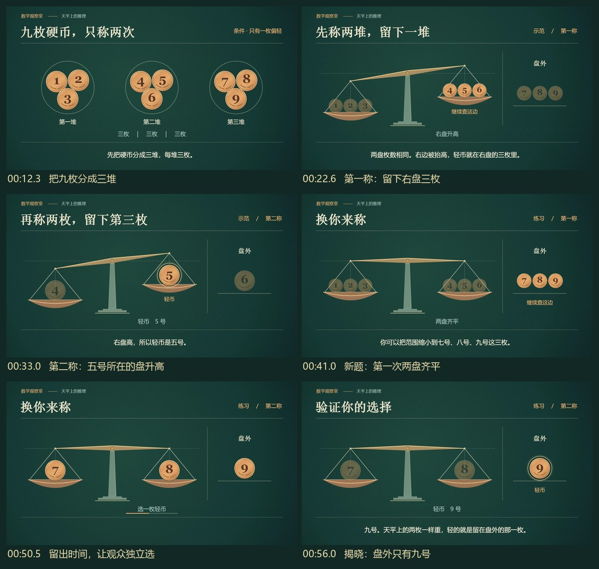

# 九枚硬币，只称两次

把九枚硬币放上天平，让观众跟着盘的高低排除不可能的号码。条件为仅一枚偏轻，其余八枚等重，使用等臂天平且没有砝码。原片的例题为 5 号，练习为 9 号。



## 拆一段拿去用

| 原片时间 | 画面与旁白怎样配合 | 改题时保留什么 |
|---|---|---|
| 0:00–0:13.33 | 从九枚带号铜币切到空天平，再让硬币聚成三堆。声音给出“只有一枚偏轻”和“两称”的条件。 | 先让观众能分辨和数清所有对象。题设中真正限制解法的条件要在第一步操作前给出。 |
| 0:13.33–0:26.79 | 1、2、3 对 4、5、6。右盘缓缓抬高，中心横虚线留在原位。解释原因时，其余六枚才变暗。 | 先展示观测，再排除候选。提前给正确组三枚换颜色会暴露答案，且抹掉观察的机会。 |
| 0:26.79–0:34.75 | 同一台天平上出现 4 对 5，6 在盘外。第二次右盘升高，五号被圈出。 | 保留第一称的编号、左右与画幅。观众能查证下一步用的是刚才留下的三枚。 |
| 0:34.75–0:48.50 | 第二题的两次称量都齐平，第二称的 7、8、9 等亮。字幕问“你选哪一枚？” | 换成另一种结果，训练观众选择新分支。在问题里只报告天平现象。 |
| 0:48.50–0:53.00 | 收掉问题字幕，保持盘的位置与亮度，下面的细线给出思考进度。此段没有配音。 | 留足可用的作答时间。暂时静音，保留观众判断用到的画面。 |
| 0:53.00–1:07.58 | 先给出口头答案，再圈盘外的九号。最后把实际用过的币排成 9 → 3 → 1。 | 答案后紧跟证据，由盘内两枚等重推到盘外剩下的一枚。 |

初版在连续两句开场里重复展示同一排硬币，首次排除时也只在盘下写提示。复看并排样帧后，把讲工具的那句话切到空秤与待称盘，解释排除时让另外六枚一起变暗。借到别的课程里，可以挑出同样的问题：观众在听到“所以”时，眼睛能否指到被排除的对象？硬币和秤盘画法见 [scene.js](scene.js) 的 `overhead`、`balance`、`weighing`。

## 换一道练习

**只换称量结果、提问或停顿，直接复制 [四格变体卡](variant.json)。** `example` 和 `practice` 各填两个现象，顺序都是第一称、第二称。每格原样选「左盘高」「右盘高」「两盘平」。`thinkingSeconds` 填独立思考秒数，`ask` 填新问题，其中 `{q_test}` 会变成实际观察。程序从现象算出编号并重写所有对应画面和语句。

把新题交给能输出结构化数据的模型时，可直接供给[四字段 JSON Schema](variant.schema.json)，再给本题的要求。生成后先运行 `python build_voice.py --variant variant.json --print-script`。把 `weigh`、`found`、`reset`、`ask` 各读一次，对照这次想讲的四次称量。比如“轻币在盘外”在画面上应当对应“两盘一样高”。这一步能在重录前发现模型沿用了上一道题。

在这个示例目录放入改好的 `variant.json`，以下两步会重新配音并在另一目录生成可渲染的工作副本。第一步使用名为晓晓的在线神经音色；也可将 `--edge-voice zh-CN-XiaoxiaoNeural` 换成 `--takes 录音目录` 使用自己的普通话录音。第二步的网页时间线与旁白均取自工作副本。

```text
python build_voice.py --variant variant.json --edge-voice zh-CN-XiaoxiaoNeural --out out/new-lesson
node ../../kit/render.mjs out/new-lesson/index.html video out/new-lesson/picture.mp4 --audio out/new-lesson/voice.m4a --mux out/new-lesson/film.mp4
```

如果要按币号出题或改其他句子，可以再打开整个素材表：

打开 [lesson.json](lesson.json)。`example` 是示范题的轻币号，`practice` 是练习题的轻币号，`thinkingSeconds` 是问完后给观众独立判断的静默秒数。每题的输入都是一枚币的整数编号。给定天平现象时，按下表交点填写编号。

第一称用 1、2、3 号对 4、5、6 号，7、8、9 号在盘外。第二称取候选组中号码最小的放左盘，第二小的放右盘，最大的一枚在盘外。

| 第一称 ↓ / 第二称 → | 左盘高 | 右盘高 | 两盘平 |
|---|---:|---:|---:|
| 左盘高 | 1 | 2 | 3 |
| 右盘高 | 4 | 5 | 6 |
| 两盘平 | 7 | 8 | 9 |

比如第一称两盘平、第二称左盘高，剩下的是 7、8、9，7 号所在的左盘更轻，故在相应题的字段填 7。保留 `cues` 里的占位符，程序会改写台词中的称量结果、编号与证明。需要换口吻时再改 `cues`。修改任何题号、句子或停顿后，先用上面的配音命令同时重出 `timing.js` 和 `voice.m4a`，再渲染影片。

## 运行

以下命令在当前示例目录执行，渲染工具及环境配置见 [工具接口](../../references/kit.md)。随附原片实用的 [逐句时序](timing.js) 和 [普通话旁白](voice.m4a)，原样渲染只需这一条。

```text
node ../../kit/render.mjs index.html video out/picture.mp4 --audio voice.m4a --mux out/film.mp4
```

本片使用微软 Edge 在线神经音色 `zh-CN-XiaoxiaoNeural`、语速 `-4%`，按每一整句的新录音重新安排镜头，没有拉长人声去填旧时间。重做配音可用自有录音或同一在线音色。先用 `python build_voice.py --print-script` 输出逐句台词。真人录音每句保存为与左列同名的 WAV，例如 `ask.wav`，再执行 `python build_voice.py --takes 录音目录`。使用在线音色时在 Python 环境安装 `edge-tts` 并准备 FFmpeg，执行 `python build_voice.py --edge-voice zh-CN-XiaoxiaoNeural`。这会向微软发送台词并生成分句 WAV。脚本按每句实际长度排时，练习后另留独立的静默段。模型可以从本片借“筛去一组 → 同法再判 → 换输入再练”的剪法，美术和题材可以重选。
